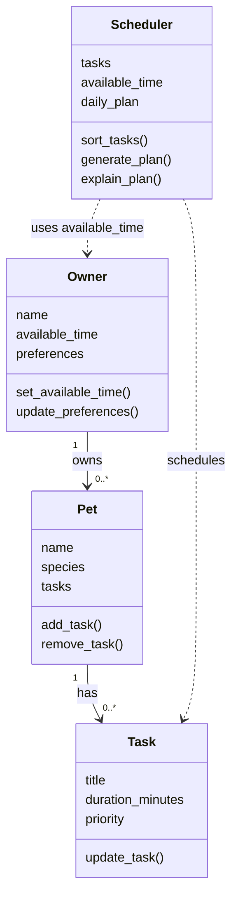

# PawPal+ Project Reflection

## 1. System Design

**a. Initial design**

Add Owner and Pet Information: The user should be able to enter basic information about themselves and their pet, such as the pet's name, type, and care needs.

Add and Manage Pet Care Tasks: The user should be able to add and edit daily tasks like feeding, walking, grooming, and giving medication. Each task should include its duration and priority.

Generate and View a Daily Care Plan: The user should be able to generate a daily schedule based on their available time and task priorities. The app should display the selected tasks and explain why they were included in the plan.

For my initial UML design, I chose four main classes: Owner, Pet, Task, and Scheduler. The Owner class stores the owner's information, available time, and preferences. The Pet class stores basic pet information and manages its care tasks. The Task class stores details about each activity, such as its title, duration, and priority. The Scheduler class is responsible for organizing tasks based on priority and available time to create a daily care plan.

In my design, one owner can have multiple pets, and each pet can have multiple tasks. The Scheduler uses this information to generate a suitable daily schedule. I kept the design simple by giving each class a specific responsibility.

**Class diagram**

**b. Design changes**

During the review of my initial design, I made some small changes to `pawpal_system.py`. I implemented methods that were previously empty, such as updating the owner's available time and preferences, adding or removing pet tasks, and updating task details.

I made these changes because the methods were only placeholders and could not perform any actions. These improvements allow each class to handle its responsibilities properly. During the initial design review, the scheduling methods were still unimplemented, but I implemented them later. I kept the original four classes and did not change my UML diagram because the overall structure remained the same.

---

## 2. Scheduling Logic and Tradeoffs

**a. Constraints and priorities**

The scheduler gathers tasks from all of the owner's pets. It skips completed tasks and tasks with non-positive durations, sorts tasks by priority when building the daily plan, and selects tasks that fit within the available time. I also added sorting by scheduled time, filtering by pet name and completion status, and conflict detection for tasks scheduled on the same date. Owner preferences are stored but are not used to build the schedule.

**b. Tradeoffs**

The daily plan uses priority order rather than scheduled-time order, so a lower-priority task may not fit after higher-priority tasks are selected. This keeps the available-time rule simple and gives higher-priority care preference. Scheduled-time sorting and conflict detection are separate checks; conflict warnings do not change the generated plan. This means users can see overlaps, but the scheduler does not automatically resolve them.

---

## 3. AI Collaboration

**a. How you used AI**

I used an AI coding assistant to help design and implement my PawPal+ project. AI helped me create the initial Mermaid UML diagram, generate Python class skeletons, and implement the methods for managing pets, tasks, and scheduling. I also used AI to review my code, identify possible issues, and help create tests. The most helpful prompts were the ones where I provided specific requirements and asked AI to keep the code simple and beginner-friendly.

**b. Judgment and verification**

One suggestion I did not accept immediately was implementing additional functionality while I was still working on the class skeletons. I wanted to follow the assignment steps, so I reviewed the suggested changes before continuing and implemented the functionality later. I kept the four original classes and made sure the Scheduler retrieved tasks from all pets using Owner.get_all_tasks().

I verified the implementation by running `main.py` and checking the generated daily schedule. I also ran pytest to check task completion and task addition. The demo included tasks from two pets, displayed them in priority order, and scheduled 60 minutes within the owner's 60 available minutes. Both tests passed.

---

## 4. Testing and Verification

**a. What you tested**

The pytest suite checks task completion and addition, priority and scheduled-time sorting, pet and completion filters, recurring daily and weekly tasks, and scheduling conflicts. The command-line demo also shows tasks from both pets, filtering, recurrence, schedule generation, and a conflict warning.

**b. Confidence**

I am somewhat confident because the demo runs and the tests cover the main new scheduling behaviors. More tests for available-time edge cases and invalid scheduled dates or times would increase my confidence.

---

## 5. Reflection

**a. What went well**

I am most satisfied with the terminal demo because it makes the generated schedule and the Scheduler's explanation easy to see.

**b. What you would improve**

In another iteration, I would improve the Scheduler to consider owner preferences or task frequency, which it does not currently use.

**c. Key takeaway**

I learned that AI is most useful when I review its suggestions and verify the results by running the program and tests.
