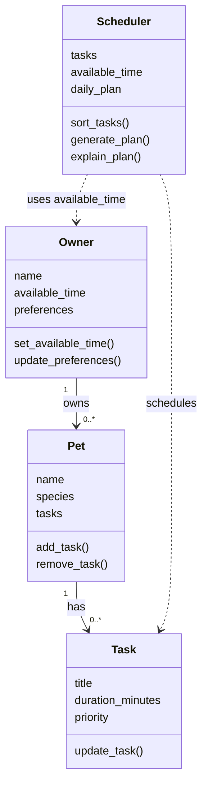

# PawPal+ Project Reflection

## 1. System Design

**a. Initial design**

Add Owner and Pet Information: The user should be able to enter basic information about themselves and their pet, such as the pet's name, type, and care needs.

Add and Manage Pet Care Tasks: The user should be able to add and edit daily tasks like feeding, walking, grooming, and giving medication. Each task should include its duration and priority.

Generate and View a Daily Care Plan: The user should be able to generate a daily schedule based on their available time and task priorities. The app should display the selected tasks and explain why they were included in the plan.

For my initial UML design, I chose four main classes: Owner, Pet, Task, and Scheduler. The Owner class stores the owner's information, available time, and preferences. The Pet class stores basic pet information and manages its care tasks. The Task class stores details about each activity, such as its title, duration, and priority. The Scheduler class is responsible for organizing tasks based on priority and available time to create a daily care plan.

In my design, one owner can have multiple pets, and each pet can have multiple tasks. The Scheduler uses this information to generate a suitable daily schedule. I kept the design simple by giving each class a specific responsibility.

**Class diagram**

**b. Design changes**

During the review of my initial design, I made some small changes to `pawpal_system.py`. I implemented methods that were previously empty, such as updating the owner's available time and preferences, adding or removing pet tasks, and updating task details.

I made these changes because the methods were only placeholders and could not perform any actions. These improvements allow each class to handle its responsibilities properly. I kept the original four classes and did not change my UML diagram because the overall structure remained the same. The scheduling methods are still unimplemented.

---

## 2. Scheduling Logic and Tradeoffs

**a. Constraints and priorities**

- What constraints does your scheduler consider (for example: time, priority, preferences)?
- How did you decide which constraints mattered most?

**b. Tradeoffs**

- Describe one tradeoff your scheduler makes.
- Why is that tradeoff reasonable for this scenario?

---

## 3. AI Collaboration

**a. How you used AI**

I used an AI coding assistant to help design and implement my PawPal+ project. AI helped me create the initial Mermaid UML diagram, generate Python class skeletons, and implement the methods for managing pets, tasks, and scheduling. I also used AI to review my code, identify possible issues, and help create tests. The most helpful prompts were the ones where I provided specific requirements and asked AI to keep the code simple and beginner-friendly.

**b. Judgment and verification**

One suggestion I did not accept immediately was implementing additional functionality while I was still working on the class skeletons. I wanted to follow the assignment steps, so I reviewed the suggested changes before continuing. I kept the four original classes and made sure the Scheduler retrieved tasks from all pets using Owner.get_all_tasks().

I verified the implementation by running main.py and checking the generated daily schedule. I also used pytest to test task completion and task addition. These checks helped me confirm that the implemented methods behaved as expected.

---

## 4. Testing and Verification

**a. What you tested**

- What behaviors did you test?
- Why were these tests important?

**b. Confidence**

- How confident are you that your scheduler works correctly?
- What edge cases would you test next if you had more time?

---

## 5. Reflection

**a. What went well**

- What part of this project are you most satisfied with?

**b. What you would improve**

- If you had another iteration, what would you improve or redesign?

**c. Key takeaway**

- What is one important thing you learned about designing systems or working with AI on this project?
